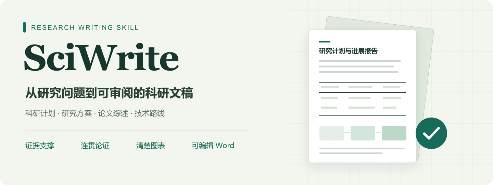

<p align="center">
  
</p>

<p align="center">
  <strong>科研项目计划书 · 研究方案 · 论文综述 · 技术路线</strong><br>
  用证据支撑研究取舍，用连贯文字说明方法，用清楚的图表呈现方案。
</p>

<p align="center">
  <a href="write-technical-plans/SKILL.md"></a>
  <a href="#示例文档"></a>
  <a href="examples/README.md"></a>
  <a href="SciWrite.zip"></a>
</p>

<p align="center">
  <a href="#示例文档">查看效果</a> ·
  <a href="#快速开始">快速开始</a> ·
  <a href="docs/usage.md">使用指南</a> ·
  <a href="write-technical-plans/SKILL.md">技能源码</a> ·
  <a href="https://github.com/2158076627-gif/SciWrite/raw/refs/heads/main/SciWrite.zip">下载技能包</a> ·
  <a href="README.en.md">English</a>
</p>

**SciWrite 是一套面向中文科研写作的 AI 技能。** 它帮助作者把研究问题组织成有依据的方案：梳理方法选择、实施步骤、资源接口与验证条件，改进学术行文，并统一 Word 排版。安装后的技能名为 **`write-technical-plans`**，显示名称为“科研项目书与计划书撰写”。

这个仓库提供完整技能文件、可调整的排版配置和 Word 格式脚本，也展示两份机器人装配主题文稿。先看真实页面，再打开 PDF 或下载 Word，可以直观了解文稿的结构与版式。

## 示例文档

以下预览由提供的 Word 文档实际渲染，PDF 为同源导出，Word 保留原文件。点击图片可阅读完整 PDF；文稿中的研究规划、引文和结果表述保留原样。

### 01 · 机器人装配研究计划

**37 页 · Word 原件与 PDF 阅读版**

<a href="examples/research-plan/Robot_Assembly_Research_Plan.pdf">
  
</a>

**观察重点：** 研究问题如何展开为方法路线，图表怎样配合正文解释，资源安排与验证条件怎样进入同一份计划书。

[在线阅读 PDF](examples/research-plan/Robot_Assembly_Research_Plan.pdf) · [下载可编辑 Word](https://github.com/2158076627-gif/SciWrite/raw/refs/heads/main/examples/research-plan/Robot_Assembly_Research_Plan.docx)

### 02 · 机器人装配进展报告

**17 页 · Word 原件与 PDF 阅读版**

<a href="examples/progress-report/Robot-Assembly-Progress-Report.pdf">
  
</a>

**观察重点：** 进展、依据与后续研究怎样衔接，技术内容如何通过图表呈现，较长文稿怎样保持清楚的章节层次。

[在线阅读 PDF](examples/progress-report/Robot-Assembly-Progress-Report.pdf) · [下载可编辑 Word](https://github.com/2158076627-gif/SciWrite/raw/refs/heads/main/examples/progress-report/Robot-Assembly-Progress-Report.docx)

更多页面信息、文件说明与来源见 [示例索引](examples/README.md)。这些文件用于展示写作组织和排版效果；两份示例尚不能构成跨领域效果评测，也不代表其中的研究主张已由本仓库独立验证。

## SciWrite 能帮助你做什么

| 写作任务 | 重点工作 | 交付内容 |
| --- | --- | --- |
| 科研项目计划书 | 连接问题、方法、资源、阶段产物和验收条件 | 结构完整、便于继续修改的项目文稿 |
| 研究方案 | 解释假设与方法依据，安排对照和失败判据 | 可审阅的实验或实施方案 |
| 论文综述与研究现状 | 按问题和方法分支组织文献，比较证据边界 | 有主题结构的综述正文 |
| 技术路线 | 明确模块输入、输出、依赖和验证 | 与正文相互对应的路线说明 |
| 原稿修订 | 保留有效观点和专业术语，补足推理，压缩重复 | 更具体、连贯的学术表达 |
| Word 格式整理 | 统一字体、行距、缩进、题注和三线表 | 保留内容的可编辑 DOCX |

### 写作与图表原则

- **先解释研究取舍。** 说明为什么选择这个问题和方法，关键判断由哪些事实或假设支持。
- **区分事实、建议与目标。** 未实测的规模、工期和效果以规划数值或待验证目标表述。
- **用连贯段落展开推理。** 减少套话、重复铺陈和机械结构，保留研究对象、条件与因果解释。
- **让图表参与论证。** 内容表格采用三线表；真实期刊或官方设备图片在相邻正文按图号解读，注明来源与使用条件。
- **交付前检查页面。** 核对表格跨页、图注相邻、字体、裁切与异常留白；排版脚本不能代替视觉检查。

<p align="center">
  
</p>

## 快速开始

### 1. 安装完整技能目录

下载 [SciWrite.zip](https://github.com/2158076627-gif/SciWrite/raw/refs/heads/main/SciWrite.zip)，解压并找到 `write-technical-plans` 文件夹；也可以克隆仓库取得这个文件夹。将整个文件夹复制到适合你的 Codex 技能目录：

| 使用范围 | 技能文件位置 |
| --- | --- |
| Windows 个人安装 | `%USERPROFILE%\.agents\skills\write-technical-plans\SKILL.md` |
| macOS / Linux 个人安装 | `~/.agents/skills/write-technical-plans/SKILL.md` |
| 当前项目 | `<项目目录>/.agents/skills/write-technical-plans/SKILL.md` |

在 Codex 中输入 `$write-technical-plans` 调用，或使用 `/skills` 查找。完整命令、更新和依赖说明见 [安装指南](docs/installation.md)。

### 2. 提供研究资料并调用

```text
$write-technical-plans

请根据附件资料撰写机器人装配研究计划。
读者：课题组负责人；目的：评审下一阶段研究方案。
已有条件：〔设备、数据、已完成工作和时间限制〕。
请解释研究问题、路线取舍、实施步骤、阶段产物和验证条件。
未确认的信息明确标注，不补造文献或实验结果。
采用三线表，输出可编辑 Word，完成后逐页检查。
```

上传原稿、已有文献和设备资料，通常能帮助技能更准确地表达实际研究条件。更多综述、技术路线和修订提示词见 [使用指南](docs/usage.md)。

### 3. 按需要统一 Word 格式

纯文字写作无需安装 Python 依赖。使用独立排版脚本时，安装 `lxml`；通过 Python 新建 Word 文档时另需 `python-docx`。

```bash
python -m pip install lxml
python write-technical-plans/scripts/apply_style.py draft.docx --output final.docx
```

脚本读取 [style.json](write-technical-plans/assets/style.json)，统一格式并保留文字、字段、链接和图片。默认采用 **A4 页面、宋体正文 12 磅、黑体标题、英文及数字 Times New Roman、正文 1.35 倍行距、首行缩进两字符、白底黑字三线表**。

一次性的版式调整可复制配置后使用 `--profile`：

```bash
python write-technical-plans/scripts/apply_style.py draft.docx --output final.docx --profile my-style.json
```

## 文件与定制入口

```text
SciWrite/
├── README.md                       中文项目主页
├── README.en.md                    English overview
├── SciWrite.zip                    原始 v1.0.0 分享包
├── write-technical-plans/
│   ├── SKILL.md                    触发范围与写作流程
│   ├── agents/openai.yaml          显示名称与默认提示
│   ├── assets/style.json           字体、行距、缩进和表格配置
│   ├── references/                 写作、综述、图表与独立运行说明
│   └── scripts/apply_style.py      Word 格式脚本
├── examples/                       两份示例的 Word 与 PDF
└── docs/                           安装、使用、维护发布与展示素材
```

| 想调整的内容 | 对应文件 |
| --- | --- |
| 字体、字号、行距、缩进、页面和表线 | [assets/style.json](write-technical-plans/assets/style.json) |
| 章节职责、段落组织和学术表达 | [writing-patterns.md](write-technical-plans/references/writing-patterns.md) |
| 综述、研究现状和技术路线组织 | [review-and-routes.md](write-technical-plans/references/review-and-routes.md) |
| 真实论文与设备配图核验和解读 | [literature-figures.md](write-technical-plans/references/literature-figures.md) |
| 三线表、技术图、统计图与阶段计划 | [tables-and-charts.md](write-technical-plans/references/tables-and-charts.md) |
| 独立制作 Word、依赖与检查 | [portable-docx.md](write-technical-plans/references/portable-docx.md) |

## 常见问题

**它是自动写论文的软件吗？**

这是提供给 AI 助手使用的技能包，由 `SKILL.md`、参考规则、配置和格式脚本组成。写作、检索与 Word 生成依赖使用环境的能力；`apply_style.py` 负责统一格式。

**可以用于其他研究方向吗？**

规则面向科研写作，示例采用机器人装配主题。迁移到新课题时，需要重新提供本领域文献、设备条件与研究约束；效果需要在具体任务中判断。

**能保证引文完全正确或通过 AI 检测吗？**

技能要求来源核验和自然、具体的表达；最终引文与研究判断仍需作者复核，不承诺检测分数。缺少联网或渲染工具时，应记录未完成的核查。

**两份示例是否随技能安装？**

安装只需复制 `write-technical-plans` 文件夹。示例 Word、PDF 和主页图片独立放在仓库中，方便查看与下载。

## 参与与维护

欢迎通过 [Issues](https://github.com/2158076627-gif/SciWrite/issues) 提交使用反馈，或参考 [贡献指南](CONTRIBUTING.md) 改进写作规则与兼容性。仓库维护、更新示例和创建 Release 的步骤见 [发布指南](docs/publishing.md)。原始分享包说明保存在 [original-user-guide.md](docs/original-user-guide.md)。

**使用与复用：** 仓库尚未声明开源许可证。技能源码与示例文稿的授权范围需由维护者确定；文稿所引用的第三方论文、图片和设备资料遵循各自的权利与复用条件。
