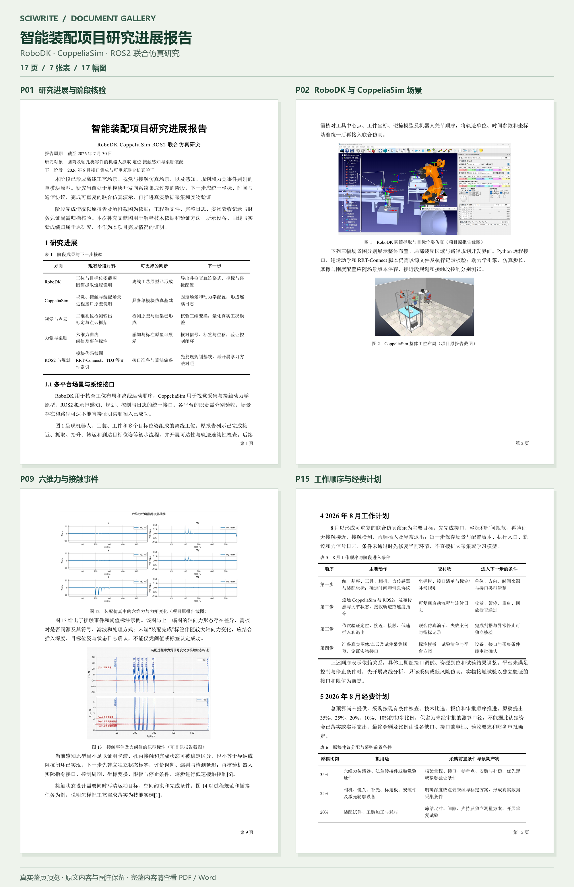
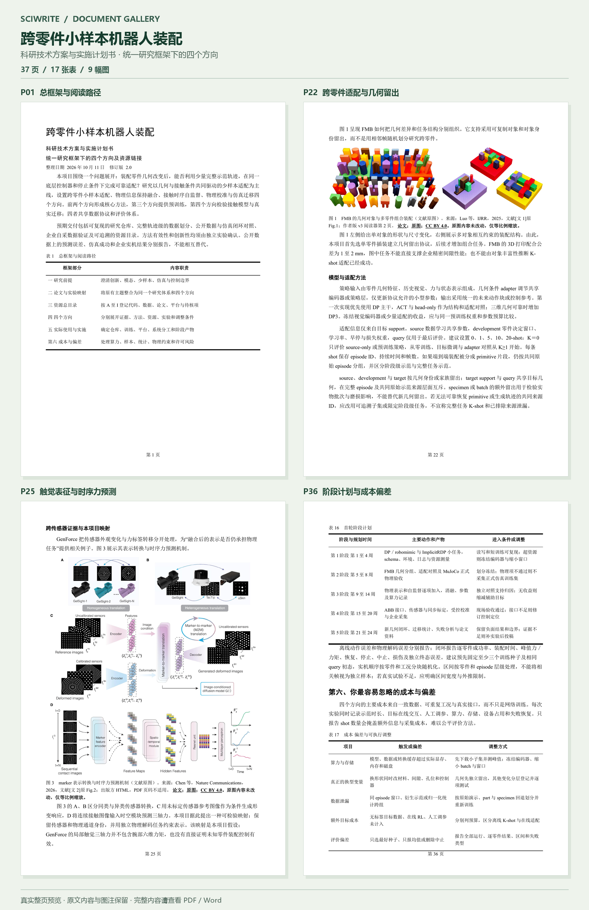

# 示例文档

这两份文档由仓库维护者提供，展示 SciWrite 面向中文科研材料的文档组织形态：研究框架、图表与来源说明、阶段核验、实施安排。它们是已有写作案例；本次展示保留 DOCX 原件，另提供便于浏览的 PDF 和真实整页预览。

| 示例 | 文档主题 | PDF 页数 | 表 / 图 | 下载 |
| --- | --- | ---: | ---: | --- |
| 研究进展报告 | 智能装配项目的多平台仿真、视觉与点云、六维力觉及后续验证 | 17 | 7 / 17 | [Word](progress-report/Robot-Assembly-Progress-Report.docx) · [PDF](progress-report/Robot-Assembly-Progress-Report.pdf) |
| 科研技术方案与实施计划书 | 跨零件少样本适配、物理信息保持融合、接触时序自监督、物理校准与仿真迁移 | 37 | 17 / 9 | [Word](research-plan/Robot_Assembly_Research_Plan.docx) · [PDF](research-plan/Robot_Assembly_Research_Plan.pdf) |

## 研究进展报告

《智能装配项目研究进展报告》以截至 2026 年 7 月 30 日的阶段材料为口径，整理 RoboDK、CoppeliaSim 和 ROS2 场景与接口，以及图像检测、点云定位、六维力觉、柔顺装配和轨迹算法储备。后续章节以表格列出经费核验状态、现存问题、8 月工作顺序及归档要求。原文同时区分项目截图与补充的文献原图。

下方为 PDF 第 1、2、9、15 页的完整页面，分别展示研究概览、仿真场景、力觉曲线与工作计划。点击图片可查看大图。

[](../docs/assets/previews/progress-report.png)

[阅读完整 PDF](progress-report/Robot-Assembly-Progress-Report.pdf) · [下载原始 Word](progress-report/Robot-Assembly-Progress-Report.docx)

## 科研技术方案与实施计划书

《跨零件小样本机器人装配 科研技术方案与实施计划书》标注整理日期为 2026 年 10 月 11 日、修订版 2.0。文档围绕跨零件适配建立四个相互关联的研究方向，包含资源目录、完整轨迹级 support/query 划分、公平对照与失败判据、平台条件、数据协议、仓库职责和阶段交付安排。9 幅文献图均保留原文中的图注与来源说明。

下方为 PDF 第 1、22、25、36 页的完整页面，分别展示总框架、几何留出与少样本适配、触觉表征机制、阶段计划与成本偏差。点击图片可查看大图。

[](../docs/assets/previews/research-plan.png)

[阅读完整 PDF](research-plan/Robot_Assembly_Research_Plan.pdf) · [下载原始 Word](research-plan/Robot_Assembly_Research_Plan.docx)

## 原件与展示版本

- 两份 DOCX 直接复制维护者提供的原件；发布副本与本地原件逐字节一致，正文、图片、图注、表格、超链接及文件元数据均保留。
- PDF 于 2026 年 10 月 11 日由 Microsoft Word 从原件导出。页数以本仓库提供的 PDF 为准；其他 Word 版本或字体环境可能重新分页。
- 预览由 PDF 的 150 dpi 整页渲染拼接而成，仅作等比例缩放并在页面外添加页码标签。两份 PDF 共 54 页已逐页检查，未发现缺字、裁切或重叠。
- 表和图的数量依据 DOCX 中的实际表格及编号图注统计；一幅编号图可能含多个子图或截图。

原始 DOCX 的 SHA-256：

全部文件的页数、大小与校验值另见 [文件清单](manifest.json)。

```text
Robot-Assembly-Progress-Report.docx
672f752261f43811d785688b89fcec91530fec619226e64ea12549a7417b061e

Robot_Assembly_Research_Plan.docx
2a07bf18d7a81ceb2af46d7837f2f111c4a2b5e24fda54c799a6ae1818a42fba
```

## 展示范围与使用边界

这些案例用于展示写作结构和文档呈现，不构成 SciWrite 的独立基准评测、效果保证或科研结论验证。本次发布检查了原件一致性、导出和显示效果；未独立复核原文中的技术结论、实验数值、项目完成状态、设备条件或全部外部链接。

文献原图及其研究结果归属于原作者。原文中的来源和许可说明按原件保留；仓库的技能许可不覆盖这些第三方材料，复用时请依据各来源说明核对使用条件。研究假设、待核事项和计划安排应按原文的证据边界阅读。
